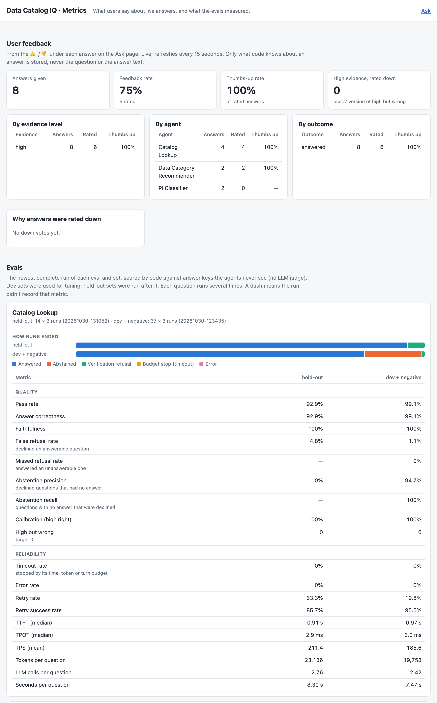

# data-catalog-iq

Ask governance questions in plain English across a data catalog: owners,
lineage, personal information (PI) and Data Categories. Every answer is
cited, verified by code before it is shown, and refused when the catalog
cannot support it. Two agents also *recommend* PI classifications and
data categories, always pending a data steward's review.

Questions it answers:

- "Who owns fct_orders and does it hold personal data?"
- "Where is sales data?"
- "Who owns revenue data?"
- "What feeds mart_finance_daily_revenue?"
- "Which data category is fct_orders assigned, and how long is it kept?"
- "Does raw_crm.contacts have personal data?" (recommends PI classifications)
- "Which data category should mart_web_sessions use?" (recommends one, with its retention and stewards)

All metadata is **synthetic**, for a fictional retailer, Fernwood Outfitters.

The demo is **unauthenticated on purpose** and meant to run locally. Don't connect
a real catalog without the production controls in [SECURITY.md](SECURITY.md).


## What it does

| Agent | Answers | Example |
|---|---|---|
| **Catalog Lookup** | What the catalog records: owners, stewards, lineage, certification, recorded PI, assigned data categories, retention, glossary | "What feeds mart_finance_daily_revenue?" |
| **PI Classifier** | Recommends PI classifications for a table's unreviewed columns | "Does raw_crm.contacts have personal data?" |
| **Data Category Recommender** | Recommends one data category to categorize a table that has none, with the retention and stewards it brings | "Which data category should mart_web_sessions use?" |
| **Router** | Picks the agent(s) for a free-text request: multi-part questions, follow-ups ("it"), and a clarifying question when a table is missing or ambiguous | "Who owns fct_orders and does it hold personal data?" |

## Architecture


### Input guardrails

- **Questions are checked before any LLM call:** empty ones and ones over 1,000
  characters are turned away.
- **People's names and emails never reach the LLM or the traces.** They become
  per-request tokens (`PERSON_3f9a2c1b`) at the provider boundary and are swapped
  back in the answer, so tools and checks still see real values.
- **An instruction hierarchy in every prompt:** only the system prompt says what
  to do; text in tool results (descriptions, definitions) is evidence, never
  instructions. See [SECURITY.md](SECURITY.md#prompt-injection).
- **The router asks when unsure.** It runs 3 times in parallel: all agree → run;
  a majority → run and offer the other reading; no majority → ask.

### Output guardrails

- **The model never has the last word.** Code checks every cited id against what
  the tools returned and every claim against its cited source, retries once with
  the problems listed, then refuses.
- **Facts that must not be generated are added by code:** the evidence level
  (from evidence signals, not the model's own certainty), retention, stewards and
  citation details.
- **Recommendations are never decisions.** PI and data category recommendations
  always wait for a data steward.

### Tools and retrieval

- **The catalog tools are an MCP server.** The agents call all nine read-only
  tools through it, and any other MCP client (a desktop app, an IDE, another
  team's agent) can call each one. Every caller gets the same checks; outside
  callers get tokens instead of names. See [below](#catalog-tools-over-mcp).
- **Hybrid RAG with a re-ranker, and no vector database.** Keyword search
  (SQLite FTS5, BM25) over data categories is the default. `RETRIEVER=hybrid`
  adds local embeddings fused with BM25, which lifts top-1 on tables described in
  other words from 8% to 96%; `hybrid+rerank` adds a cross-encoder.


### Tracing and audit trail

- **Every LLM call, tool call and guardrail check is a span** (OpenTelemetry,
  viewable in Arize Phoenix), with names already swapped for tokens.
- **Every ingestion attempt is logged** with what changed; only builds that pass
  their checks are published, and `--rollback` restores the previous one.
- **Every answer says which catalog it came from:** its version and `as_of`
  date, with a warning when it is over 7 days old or the last update failed.
- **Every answer is logged** with its agent, status, evidence level, outcome,
  retries, model and catalog build, but no question or answer text. 👍 / 👎
  ratings attach to that record, with a reason from a fixed list.
- **Every eval run is kept:** its answers, tool calls and scores.

### Limits and reliability

- **Every run has a budget:** 60 s and 100k tokens per agent run, 20 s and 30k
  for routing; no LLM call starts past it.
- **The LLM endpoints allow 4 requests at once and 10 a minute per client.** One
  process answers about 30 questions a minute; [load test](SECURITY.md#capacity).
- **Answers stream as they happen** ("Walking the lineage of fct_orders
  upstream"), a question's parts run in parallel, and no LLM call starts once the
  client leaves.

### Evaluation

- **Code scores every agent against answer keys it never sees,** with no LLM
  judge: dev sets for tuning, held-out sets run after it.
- **Prompt injection is tested:** instructions planted in catalog text were
  followed in 0 of 33 runs.
- **One dashboard** puts live feedback next to the latest eval runs ([below](#dashboard)).

### Feedback loop

1. **Users rate each answer** 👍 / 👎 on the page; a down vote takes a reason from
   a fixed list (wrong, incomplete, should have answered, not helpful).
2. **The rating attaches to the answer's record** (agent, evidence level, outcome,
   retries, model, catalog build), never to its text, so a client can't claim a
   different agent or evidence level.
3. **The dashboard compares users with the evals:** thumbs-up rate by agent,
   evidence level and outcome, and "high evidence, rated down", the users'
   version of the evals' high-but-wrong.
4. **A down vote becomes an eval case:** someone reads it, writes the question
   and its answer key into a dev set, fixes the agent, and the evals confirm the
   fix without breaking held-out results.

`catalog-iq feedback` and `GET /feedback/summary` return the same numbers as JSON.

## Quick start

Requires Python 3.11+ and an Anthropic API key.

```bash
python -m venv .venv && source .venv/bin/activate
pip install -e ".[api,dev]"
cp .env.example .env               # then set ANTHROPIC_API_KEY in .env

python scripts/generate_warehouse.py   # synthetic warehouse (gitignored)
python scripts/ingest_catalog.py       # builds data/catalog/catalog.db (gitignored); --rollback undoes the last publish

catalog-iq serve                       # http://127.0.0.1:8000
```

From the command line:

```bash
catalog-iq ask "Who owns dim_customers?"
catalog-iq recommend-pi raw_returns.return_requests
catalog-iq recommend-category mart_web_sessions
catalog-iq route "Who owns fct_orders and does it hold personal data?"   # routing only
catalog-iq ask "..." --verbose                                          # tool calls, guardrails, tokens
```

## API

| Endpoint | Body | Returns |
|---|---|---|
| `POST /ask` | `{request, history?}` | `{decision, answers, catalog}`: the router's decision, one agent response per route, and the catalog's version and age |
| `POST /ask/stream` | `{request, history?}` | the same as newline-delimited JSON events: `progress`, `decision`, one `answer` per route (with `route_index`, as each finishes), then `done` or `error` |
| `POST /agents/catalog_lookup` | `{request}` | one agent, no router |
| `POST /agents/pi_classifier` | `{table}` | one agent, no router |
| `POST /agents/data_category_recommender` | `{table}` | one agent, no router |
| `POST /feedback` | `{answer_id, rating, reason?}` | rate one answer 👍 / 👎 (the page's buttons) |
| `GET /feedback/summary` | | feedback rate, thumbs-up rate by agent, evidence level and outcome |
| `GET /dashboard` | | metrics page: user feedback, and quality and reliability from the latest eval runs |
| `GET /tables` | | source and mart tables |
| `GET /catalog` | | catalog version, `as_of`, age, `stale`, last failed ingestion |
| `GET /health` | | catalog loaded and fresh, providers configured |

Interactive docs at `/docs` while the server runs. The API is stateless: the
client sends up to 3 earlier turns as `history`.

## Catalog tools over MCP

`catalog-iq mcp` serves the nine read-only tools to one MCP client over stdio:
`find_table`, `get_table`, `get_lineage`, `trace_path`, `filter_tables`,
`get_columns`, `get_data_category_evidence`, `search_data_categories` and
`get_data_category`. Every result carries citation ids. For a client that starts MCP
servers from a config file, add:

```json
{"mcpServers": {"catalog-iq": {"command": "/path/to/data-catalog-iq/.venv/bin/catalog-iq", "args": ["mcp"]}}}
```

The client's own LLM writes the answer, so it gets cited facts but not the
agents' answer checks. People's names and emails come back as tokens
(`PERSON_3f9a2c1b`) that stay the same within a session. See
[SECURITY.md](SECURITY.md#catalog-tools-over-mcp).

## Evals and tests

```bash
pytest                                   # no network
python -m catalog_iq.evals.run           # Catalog Lookup (dev + negative)
python -m catalog_iq.evals.run --suite grounding --sets dev heldout   # false premises, planted text, counterfactuals
python -m catalog_iq.evals.pi            # PI Classifier
python -m catalog_iq.evals.data_category # Data Category Recommender (open + dev)
python -m catalog_iq.evals.router        # Router (dev)
python -m catalog_iq.evals.pi --suite injection --sets dev             # instructions planted in catalog text
python -m catalog_iq.evals.data_category --suite injection --sets dev  # (descriptions, data category definitions)
python -m catalog_iq.evals.retrieval     # data category search: BM25 vs hybrid, no LLM (needs .[hybrid])
# add --sets heldout once tuning is finished
```

Optional tracing to Arize Phoenix: `pip install -e ".[trace]"`, run
`phoenix serve`, set `PHOENIX_COLLECTOR_ENDPOINT` in `.env`.

## Layout

```
data/sources/        synthetic Collibra-style export, ODCS contracts, dbt manifest
scripts/             warehouse generator, catalog ingestion, data category scale-test catalog, API load test
src/catalog_iq/
  core/              agent loop, providers (Anthropic, Gemini), guardrails, citation checks, tracing
  tools/             read-only catalog tools
  mcp_server.py      the tools as one MCP server: checks for every caller, tokens for outside callers
  agents/            catalog_lookup, pi_classifier, data_category_recommender (prompt, schema, guard, route spec)
  router/            routing, route specs, sample agreement
  evals/             runners and scoring
  api.py, web/       FastAPI app and the web page
evals/               questions and answer keys (run outputs are gitignored)
```

## Dashboard

`/dashboard` shows every metric on one page: live 👍 / 👎 feedback next to the
newest complete run of each eval and set, split into quality and reliability.
Every agent runs on the same small, fast model. Code scores each run against
answer keys the agents never see, with no LLM judge; dev sets were used for
tuning and held-out sets were run after it. What the evidence level means, and
how often "high" was right, is in [SECURITY.md](SECURITY.md#what-the-evidence-level-means).



The [full page](docs/dashboard-full.png) adds the Grounding, PI Classifier, Data Category Recommender and Router evals.

## License

MIT
