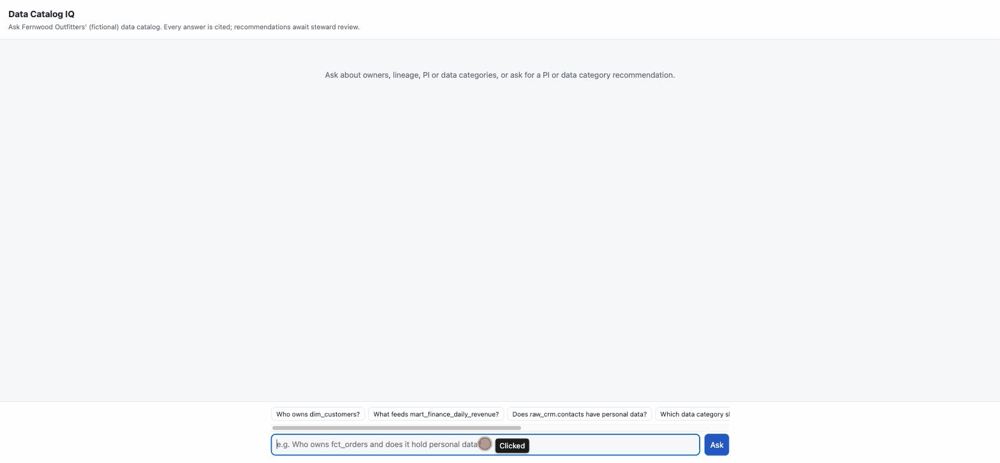
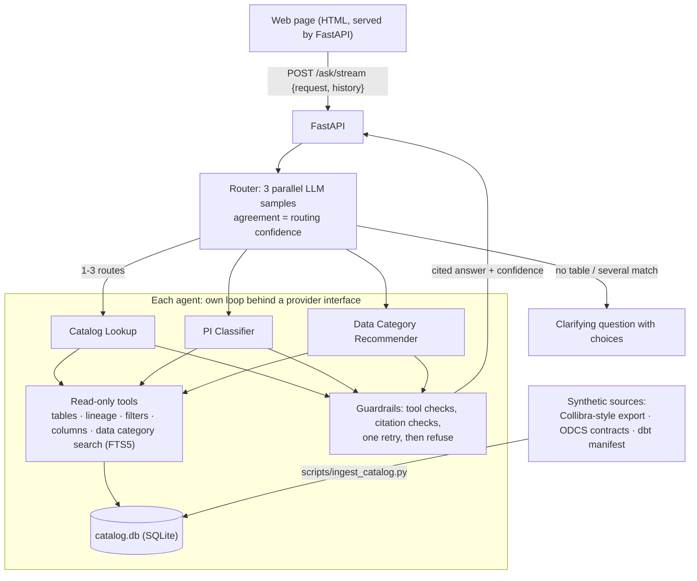

# data-catalog-iq

Ask governance questions in plain English across a data catalog: owners,
lineage, personal information (PI) and Data Categories. Every answer is
cited, verified by code before it is shown, and refused when the catalog
cannot support it. Two agents also *recommend* PI classifications and
data categories, always pending a data steward's review.

All metadata is **synthetic**, for a fictional retailer, Fernwood Outfitters.

The demo is **unauthenticated on purpose** and meant to run locally. Don't connect
a real catalog without the production controls in [SECURITY.md](SECURITY.md).



## What it does

| Agent | Answers | Example |
|---|---|---|
| **Catalog Lookup** | What the catalog records: owners, stewards, lineage, certification, recorded PI, assigned data categories, retention, glossary | "What feeds mart_finance_daily_revenue?" |
| **PI Classifier** | Recommends PI classifications for a table's unreviewed columns | "Does raw_crm.contacts have personal data?" |
| **Data Category Recommender** | Recommends one data category to categorize a table that has none, with the retention and stewards it brings | "Which data category should mart_web_sessions use?" |
| **Router** | Picks the agent(s) for a free-text request: multi-part questions, follow-ups ("it"), and a clarifying question when a table is missing or ambiguous | "Who owns fct_orders and does it hold personal data?" |

## Architecture



- **The model never has the last word.** Each agent ends with a typed draft;
  code checks every cited id against what the tools returned, rejects claims
  that aren't in the cited source, retries once with the problems listed, then
  refuses.
- **Facts that must not be generated are added by code:** confidence (from
  evidence signals, not the model's own certainty), retention, stewards,
  citation details.
- **Routing confidence is measured, not self-reported:** the router runs 3
  times in parallel. All agree → run; a majority → run and offer the other
  reading ("Or did you mean …?"); no majority → ask.
- **People's names and emails never reach the LLM or the traces.** They are
  swapped for per-request tokens (`PERSON_3f9a2c1b`) at the provider boundary and
  swapped back in the answer, so tools and guardrails still see real values.
  See [SECURITY.md](SECURITY.md).
- **Every run has a budget.** Each agent run gets 60 s and 100k tokens, the
  router 20 s and 30k; no LLM call starts past it and retries only wait if the
  wait fits. The LLM endpoints allow 4 requests at once and 10 a minute per
  client. See [SECURITY.md](SECURITY.md#limits).
- **The page shows where a question is.** `/ask/stream` sends each step as it
  happens ("Walking the lineage of fct_orders upstream", "Trying again: a claim
  wasn't in its cited source"), runs a question's parts in parallel, and stops
  calling the LLM when the client leaves. One process answers 4 questions at once,
  about 30 a minute; [load test](SECURITY.md#capacity).
- **Every answer says how old the catalog is.** Ingestion publishes only a build
  that passes its checks, logs every attempt and can roll back; each response
  carries the catalog's version and `as_of` date, and the page warns when it is
  over 7 days old or the last update failed. See
  [SECURITY.md](SECURITY.md#catalog-freshness).
- **No vector database.** Retrieval is metadata filters, lineage walks and
  SQLite FTS5 keyword search over data categories. A scale test with 5,013
  data categories kept recall@20 at 98.9% (the agent re-searches), so
  embeddings weren't needed.

## Results

Haiku (`claude-haiku-5-5`) for every agent. Dev sets were used for tuning;
held-out sets were run after tuning. Ground truth is never visible to the
agents.

| Eval | Dev | Held-out |
|---|---|---|
| Catalog Lookup (pass rate; refusals on unanswerable questions 100%) | 96.3% | 88.1% |
| PI Classifier (precision / recall) | 100% / 100% | 100% / 100% |
| Data Category Recommender (exact match; precision of recommendations) | 83.3%; 88.7% | 79.2%; 100% |
| Data Category Recommender, scale catalog of 5,013 data categories (exact match, all 30 tables) | 82.2% | |
| Router, 41 requests × 3 runs (route and table accuracy) | 100% | 100%* |

The Data Category Recommender's held-out misses are manual reviews or "no fit",
never a wrong data category. \*The router's held-out score was 91.7% until a
fix: "the orders data" resolved to the table named `orders` instead of asking
which of `orders` and `fct_orders` was meant. The fix (a plain-word name that
another table also matches now asks) was tested on new dev requests, but the
held-out set is no longer unseen.
Details and caveats are in the eval run summaries (`evals/*/runs/`, not
committed).

## Quick start

Requires Python 3.11+ and an Anthropic API key.

```bash
python -m venv .venv && source .venv/bin/activate
pip install -e ".[api,dev]"
cp .env.example .env               # then set ANTHROPIC_API_KEY in .env

python scripts/generate_warehouse.py   # synthetic warehouse (gitignored)
python scripts/ingest_catalog.py       # builds data/catalog/catalog.db (gitignored); --rollback undoes the last publish

catalog-iq serve                       # http://127.0.0.1:8000
```

From the command line:

```bash
catalog-iq ask "Who owns dim_customers?"
catalog-iq recommend-pi raw_returns.return_requests
catalog-iq recommend-category mart_web_sessions
catalog-iq route "Who owns fct_orders and does it hold personal data?"   # routing only
catalog-iq ask "..." --verbose                                          # tool calls, guardrails, tokens
```

## API

| Endpoint | Body | Returns |
|---|---|---|
| `POST /ask` | `{request, history?}` | `{decision, answers, catalog}`: the router's decision, one agent response per route, and the catalog's version and age |
| `POST /ask/stream` | `{request, history?}` | the same as newline-delimited JSON events: `progress`, `decision`, one `answer` per route (with `route_index`, as each finishes), then `done` or `error` |
| `POST /agents/catalog_lookup` | `{request}` | one agent, no router |
| `POST /agents/pi_classifier` | `{table}` | one agent, no router |
| `POST /agents/data_category_recommender` | `{table}` | one agent, no router |
| `GET /tables` | | source and mart tables |
| `GET /catalog` | | catalog version, `as_of`, age, `stale`, last failed ingestion |
| `GET /health` | | catalog loaded and fresh, providers configured |

Interactive docs at `/docs` while the server runs. The API is stateless: the
client sends up to 3 earlier turns as `history`.

## Evals and tests

```bash
pytest                                   # 413 tests, no network
python -m catalog_iq.evals.run           # Catalog Lookup (dev + negative)
python -m catalog_iq.evals.pi            # PI Classifier
python -m catalog_iq.evals.data_category # Data Category Recommender (open + dev)
python -m catalog_iq.evals.router        # Router (dev)
# add --sets heldout once tuning is finished
```

Optional tracing to Arize Phoenix: `pip install -e ".[trace]"`, run
`phoenix serve`, set `PHOENIX_COLLECTOR_ENDPOINT` in `.env`.

## Layout

```
data/sources/        synthetic Collibra-style export, ODCS contracts, dbt manifest
scripts/             warehouse generator, catalog ingestion, data category scale-test catalog, API load test
src/catalog_iq/
  core/              agent loop, providers (Anthropic, Gemini), guardrails, citation checks, tracing
  tools/             read-only catalog tools
  agents/            catalog_lookup, pi_classifier, data_category_recommender (prompt, schema, guard, route spec)
  router/            routing, route specs, sample agreement
  evals/             runners and scoring
  api.py, web/       FastAPI app and the web page
evals/               questions and answer keys (run outputs are gitignored)
```

## License

MIT
